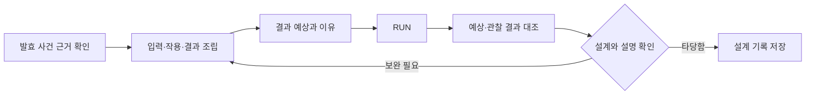

# 태블릿 탐구 경험 설계

> 2026-10-18 변경: 현재 구현 기준은 [가로 태블릿 탐험 v1.2](TABLET_EXPLORATION.md)다. 2D Phaser 탐험·작업대·코어와 단계별 도구 UI가 이전 3D/2.5D 지정을 대체한다. 아래 v1.1 내용은 당시 설계 기록이며, 학습 완료 조건은 유지한다.

- 버전 1.1 · 2026-10-16 · 상태: 설계 완료, 구현·교과·실기기 검증 전.
- 근거: 사용자 승인한 상호작용 개선안. [PRD](PRD.md), [TRD](TRD.md), [미션 계약](mvp-spec.json), [검증 계획](IMPLEMENTATION_PLAN.md)에 함께 반영한다.
- 기존 5장·학습 활동 10개·총 15화면, 지도만 2.5D, 5장과 최종 코어 실제 3D, 동등한 2D 대체 조작을 유지한다.

## 1 경험의 목표

학생이 “내 손으로 관찰 조건과 자료를 바꾸니 새 사실을 발견했고, 그 근거로 생각을 고쳤다”고 느끼게 한다. 모든 미션은 **조작 → 관찰 변화 → 근거 저장 → 설명 확인/수정**으로 이어진다. 처음부터 타당한 설명을 만든 학생에게 오답이나 수정을 강제하지 않는다.

태블릿의 가치는 대상에 직접 손을 대고 조절·표시·비교하는 경험이다. 마우스·키보드로도 같은 학습이 가능해야 하며 카메라, 마이크, 기기 흔들기나 멀티터치를 필수로 삼지 않는다. 지도 이동·3D 외형·보상 연출은 탐구를 돕지만 학습 성취의 증거는 아니다.

| 장 | 인쇄하면 사라지는 핵심 경험 | 학생이 남기는 근거 | 대표 행동 |
|---|---|---|---|
| M1 | 초점·밝기·배율·시야를 바꾸며 보이는 특징을 발견 | 자신의 촬영 상태와 특징 표시 | 조절·탐색·표시 |
| M2 | 이동을 따라가고 재생 위치를 바꾸며 위치 변화를 비교 | 같은 대상의 두 시점과 이동 기록 | 추적·멈춤·재생 |
| M3 | 연결한 자료를 바꾸면 주장별 근거 상태가 즉시 갱신 | 주장과 원문 구간의 연결 | 연결·해제·검토 |
| M4 | 시간을 앞뒤로 탐색하고 변화 전후를 고정하여 대조 | 같은 표본의 두 시점과 변화 표시 | 시간 탐색·고정·비교 |
| M5 | 자기 설계를 실행하고 예상과 결과, 이전 실행을 비교 | 설계 버전별 예상·실행·설명 | 예상·조립·가동·수정 |

## 2 화면 구성과 터치 규칙

관찰 중에는 현상이, 정리 중에는 학생의 기록이 가장 크게 보인다. 완성된 보고서나 정답 표를 활동 시작 때 보여주지 않는다. 청록·남색 연구소와 밝은 노트 패널의 기존 색조를 유지한다. 캐릭터는 도입과 요청한 도움에서 짧게 등장하고 탐구 중에는 접힌다.

1280×800 기준 설계 배치(실제 UI는 반응형 grid, 수치는 시안 기준):

```text
┌──────────────────────────────────────────────────────────────┐
│ 홈 · 이전        현재 탐구 / 한 문장 질문           소리 · 설정 │ 64
├───────────────────────────────────────┬──────────────────────┤
│                                       │ 선택한 근거 / 도구    │
│        직접 만지는 관찰·실험 영역       │                      │
│        (중앙 영역 폭의 약 70%)          │ 필요할 때만 상세 펼침 │
│                                       │                      │
├───────────────────────────────────────┴──────────────────────┤
│ 맥락 도구: 초점 / 시간 / 재생 / 연결 / 실행 중 해당 도구만      │ 96
├──────────────────────────────────────────────────────────────┤
│ 연구 가방 · 되돌리기                현재 단계의 주요 행동 1개  │ 72
└──────────────────────────────────────────────────────────────┘
```

- 1024×768에서는 오른쪽 보조 패널을 접이식으로 바꾸고 필요한 비교 화면만 두 칸으로 쓴다. 전체 화면을 축소해 터치 영역을 줄이지 않는다. 1280×720도 필수 레이아웃 검증에 포함한다.
- 관찰/정리 전환은 같은 route 안의 상태다. 새 화면을 추가하지 않는다. 짧은 안내 → 조작 → 필요한 순간의 설명 순서로 공개한다.
- 현미경은 관찰/표시 모드, 3D는 배치/보기 모드를 명시해 드래그와 주석·카메라 회전 충돌을 막는다. 모드별 커서·도구 라벨을 함께 바꾼다.
- 주석 지점은 손가락 옆 확대창에 표시한다. 확대창은 반대쪽 여유 공간으로 옮겨 가장자리 잘림을 피한다. 찍기→위치 미세 조절→확정 방식도 제공한다.
- 드래그 중 도착 예상 위치만 표시하고 놓을 때 확정한다. 취소 시 마지막 확정 상태로 복귀한다. 슬롯은 선택→자리 선택으로도 조작한다.
- 시간 막대·초점은 DOM range와 이전/다음 또는 −/+ 버튼을 제공한다. 버튼·슬라이더 손잡이의 실제 터치 영역은 48px 이상, 주요 버튼은 높이 56px 이상이다.
- 모든 변경은 조작 중 화면에 반영한다. 느린 작업은 진행 상태를 표시하되 애니메이션을 기다려야 자료를 읽을 수 있는 구조로 만들지 않는다.
- 되돌리기는 초안의 마지막 의미 있는 변경 단위다. 포인터 이동 프레임마다 되돌리기 항목을 만들지 않는다. 완료한 연구 기록은 불변 스냅샷으로 유지한다.
- 색만으로 판단하지 않는다. “근거 부족”, “확인 가능”, “이 자료와 맞지 않음” 같은 상태와 아이콘을 함께 표시한다. 정답을 찾는 게임처럼 녹색 위치를 미리 알려주지 않는다.
- 높이는 실제 viewport와 safe-area를 반영한다. 큰 글씨에서는 보조 설명을 패널 내부 스크롤로 옮기고 중앙 조작·주요 행동은 남긴다.

## 3 M1 — 초점을 맞추니 특징이 보인다 (6분)

질문: “이 사진에서 실제로 확인할 수 있는 특징은 무엇일까요?”

1. 표본실에서 버섯·곰팡이의 발견 환경 단서를 서로 다른 종류로 2개 모은다. 렌즈는 자료를 확대하는 도구이며 보이지 않는 성분을 탐지하는 만능 스캐너로 표현하지 않는다.
2. 현미경의 낮은 배율에서 전체 위치를 찾고 초점·밝기를 조절한다. 배율 변경 시 같은 표본 좌표를 중심으로 시야가 바뀌어 세부와 전체의 차이가 보인다.
3. 촬영한 사진을 “기준 사진”으로 고정하고 현재 시야와 나란히 볼 수 있다. 비교를 위해 일부러 흐린 사진을 찍게 하지는 않는다.
4. 촬영본에서 특징을 탭하거나 선으로 표시한다. 같은 특징의 여러 점을 중복 세어 완료시키지 않는다. 어떤 특징인지 짧은 라벨을 선택하고 환경 자료와 함께 설명한다.

상태: 표본 선택 → 조절 → 촬영 → 특징 표시 → 근거 설명. 어느 단계에서나 촬영으로 돌아갈 수 있으며 이전 사진은 자동 삭제하지 않는다.

| 상황 | 즉시 반응 | 안내 예시 |
|---|---|---|
| 초점/밝기 변경 | 실제 표시 영상의 선명도·노출 변화 | “형태가 구분되는지 확인해 보세요.” |
| 확대 후 대상이 시야 밖 | 전체 위치 미니맵과 현재 시야 표시 | “전체 위치를 보거나 시야를 옮겨 보세요.” |
| 흐린 사진에서 특징 주장 | 사진은 보관, 유효 근거 조건 미충족 | “이 사진에서는 표시한 특징을 확인하기 어려워요.” |

완료는 기존 조건 유지: 표본별 유효 사진 각 1장, 유효 특징 표시 총 2곳 이상, 환경 단서 2종, 근거 설명. 비교 뷰 사용 횟수·다이얼 이동량은 채점하지 않는다. E1은 사진·관찰 조건·표시·설명을 보관한다.

## 4 M2 — 지나간 움직임을 다시 관찰한다 (6분)

질문: “같은 생물이 시간에 따라 어디로 움직였나요?”

1. 채집실에서 단계대로 표본을 준비한다. 양에 따른 상태와 수정 방법을 보여주되 손의 누르기 정확도를 성취 점수로 삼지 않는다.
2. 해캄을 관찰하고 짚신벌레를 추적하거나 보조 관찰로 기록한다. 추적 완료 직후 정답·비교 문장을 자동 생성하지 않는다.
3. 재생 막대를 앞뒤로 움직이며 같은 대상의 두 시점을 A/B로 고정한다. 재생/멈춤·이전/다음 장면을 모두 제공한다. 동작 줄이기는 처음부터 정지된 장면 탐색으로 시작한다.
4. 경로 겹쳐 보기를 켜서 두 위치를 비교하고, 생김새·움직임·채집 환경을 각 기록에 연결한다. 생김새는 촬영본, 움직임은 시점 쌍, 환경은 채집 기록을 근거로 쓴다.

핵심: 카메라를 움직인 것과 생물이 움직인 것을 구분한다. 경로와 A/B 비교는 표본의 고정 좌표계로 정렬한다. 서로 다른 개체의 사진을 한 개체 이동처럼 연결하지 않는다. 교육용 경로는 계속 “움직임 설명 모형”으로 표시하며 실제 속도·궤적의 측정값처럼 소개하지 않는다.

완료: 기존 표본·두 생물 기록·3항목 비교에 더해 움직임 설명이 같은 기록의 서로 다른 두 시점에 연결되어야 한다. 자유 추적과 보조 관찰은 같은 근거 조건을 쓴다. 빠른 손놀림, 재생 횟수, 경로를 정확히 따라 그린 정도는 채점하지 않는다. E2에 source/track, A/B 시점, 비교 문장을 보관한다.

## 5 M3 — 내 설명을 뒷받침하는 자료를 찾는다 (5분)

질문: “이 자료만으로 이 설명을 할 수 있을까요?”

1. 자료 후보 6개 중 하나를 열어 사진·발견 장소·관찰 메모의 원문을 본다. 카드 제목만 보고 정답을 고를 수 없도록 한다.
2. 분석실에서는 특징/사는 곳 중 주장 하나를 먼저 선택한다. 근거를 연결하면 관련 원문 구간을 나란히 표시한다. 학생이 읽고 선택한 구간 ID가 연결에 포함된다.
3. 연결을 추가·해제·교체할 때 해당 주장만 다시 판정한다. 다른 주장에 필요한 근거를 임의로 지우지 않는다.
4. 원문과 설명을 대조하여 현재 설명을 유지하거나 바꾼다. 불일치는 이 자료의 뒷받침 여부이지 현실 전체에 대한 참/거짓 판정이 아니다.

| 상태 | 의미 | 다음 행동 |
|---|---|---|
| 근거 부족 | 현재 자료만으로 확인할 수 없음 | 다른 유형 자료 열기 |
| 확인 가능 | 검수된 해당 구간이 주장을 뒷받침 | 원문과 설명 확인 |
| 이 자료와 맞지 않음 | 검수된 구간과 선택 설명이 불일치 | 원문 다시 보기/설명 수정 |

예: 장소 정보가 없는 사진을 사는 곳 설명에 연결하면 “이 사진에 발견 장소도 기록되어 있나요?”라고 안내한다. “사진은 항상 장소 근거가 될 수 없다”는 고정 규칙을 만들지 않는다. 출처별 메타데이터로 판정한다.

완료는 기존 자료 3종·관련 근거 3개 이상·특징과 장소 설명을 유지하고, 각 설명은 실제 원문 구간을 참조해야 한다. 일부러 틀린 연결을 하거나 연결 해제를 해 보는 행동은 의무가 아니다. E3에 주장·source·segment·지원 상태를 저장한다.

## 6 M4 — 시간을 되돌려 사건의 변화를 발견한다 (8분)

대표 탐구는 **빵 곰팡이 사건**이다. 나머지 요구르트·낙엽 분해·물속 먹이 관계는 간단한 근거 확인과 비교로 구성한다. 옛 시안의 꿀벌·녹조·대나무 사례와 완성된 표를 재사용하지 않는다.

질문: “언제 어떤 변화가 보였고, 이 상황에는 어떤 영향이 있나요?”

### 사건실: 3분 대표 탐구 + 3분 나머지 사건 확인

1. 같은 표본·촬영 조건의 검수된 빵 관찰 자료를 최소 4시점 제공한다. 날짜/경과 시간은 원자료에 있는 값만 표시한다. 시간 정보가 없으면 ‘관찰 순서’로 표기한다.
2. 시간 막대를 움직이면 해당 관찰 장면이 바뀐다. 관측하지 않은 중간 상태를 합성하지 않고 기록 지점으로 이동한다.
3. 학생이 변화를 발견한 이전/이후 시점을 A/B로 고정한다. “처음 변화가 시작된 정확한 시간”을 맞히게 하지 않고 “기록에서 변화가 확인되는 구간”을 찾게 한다.
4. 같은 위치의 A/B를 나란히 보거나 경계를 밀어 비교하고 변화 영역을 표시한다. 시간 막대 드래그와 비교 경계 드래그는 다른 모드로 나눈다.
5. 관찰 시점 쌍·표시는 하나의 변화 근거로 저장한다. 해당 생물/작용을 확인할 별도 검수 자료를 연결한다. 서로 다른 사진 두 장만으로 생물의 정체나 인과관계가 입증됐다고 판정하지 않는다.
6. 나머지 사건은 사건별 원자료 2종을 확인한다. 낙엽 분해는 검수된 전후 기록을 제공하지만 긴 시간 탐색을 다시 강제하지 않는다. 원생생물 사례는 검수된 대상이 확정되기 전까지 임시 도식 표시를 유지한다.

### 분석실: 2분 맥락 비교

빵 이용 / 낙엽 분해 상황을 나란히 놓고 변화 근거·관련 작용·이 상황의 영향을 연결한다. “균류는 언제나 해롭다” 같은 설명을 선택하면 다른 사건의 기록을 다시 열 수 있다. 완성 표는 학생이 만든 연결을 정리한 결과로만 나타난다.

완료: 4개 사건 각각 독립적인 근거 2개 이상과 설명, 빵의 유효한 시점 쌍과 변화 표시, 빵·낙엽 상황 비교 설명. 같은 시점 두 번 고정, 표본이 다른 사진 쌍, 표시만 있고 변화가 없는 쌍은 시간 근거로 인정하지 않는다. 유효한 전후 조합은 여러 개를 허용한다. E4에는 시점 쌍·표시·별도 작용 근거·맥락 설명을 보관한다.

## 7 M5 — 내 설계가 예상대로 작동하는지 시험한다 (6분)

질문: “선택한 재료와 생물의 작용으로 어떤 결과를 설명할 수 있을까요?”



조립은 약 2분, 실행·대조·필요한 수정은 약 3분, 기록은 약 1분으로 시작해 파일럿에서 조정한다. 실제 제조 실험이 아니라 입력→생물 작용→결과의 관계 모델임을 화면에 짧게 표시한다.

1. E4의 요구르트 사건 근거를 작업대 서랍에서 꺼낸다. 독립적인 새 정답 설명문을 읽게 하지 않는다.
2. 모듈을 배치하고 내용을 선택해 흐름을 연결한다. 공간 배치와 학습상 연결을 분리하여 회전각·자리 모양으로 답이 노출되지 않게 한다.
3. RUN 전에 예상 결과와 이유를 짧은 문장 선택으로 남긴다. 예상의 오답은 감점하지 않으며 과거 예상은 덮어쓰지 않는다.
4. RUN에서 입력·작용·결과 단계가 현재 설계에 맞게 진행된다. 투명창과 흐름선을 사용하고, 각 단계의 자료 근거를 열 수 있다.
5. 실행이 끝나면 예상과 관찰 결과를 나란히 표시한다. 이전 실행이 있으면 설계 변경점과 결과를 비교한다. 정답 모듈 위치를 자동 배치하지 않는다.
6. 수정 후에는 새 예상과 새 실행 기록을 만든다. 처음 성공하면 예상/결과 확인과 근거 설명만으로 완료한다.

| 실행 유형 | 모델의 반응 | 피드백 |
|---|---|---|
| 연결 누락 | 해당 구간에서 흐름 중단 | “이 단계 다음으로 이어지는 연결이 없어요.” |
| 사례와 생물/작용 불일치 | 작용 단계의 근거가 확인되지 않음 | “선택한 자료가 이 작용을 뒷받침하는지 확인해 보세요.” |
| 결과 선택 불일치 | 선택 결과가 사례 근거와 연결되지 않음 | “선택한 결과를 이 사례에서 확인할 수 있나요?” |
| 유효 관계 | 입력→작용→결과 흐름과 검수된 결과 설명 | 학생의 예상과 대조한 뒤 설명 확정 |

잘못된 연결에 임의의 독성·폭발·생물 생성 같은 결과를 만들지 않는다. 관찰 결과는 실제 제조 예측이 아니라 검수된 교육용 모델의 출력이다.

완료: 기존 사례 근거·유효 그래프·생물 작용·성공 RUN·설명에, 해당 RUN 전 예상과 예상/관찰 대조가 연결되어야 한다. 성공 후 설계를 수정하면 이전 성공을 현재 초안의 통과로 쓰지 않는다. E5는 성공 설계 스냅샷과 예상·결과·근거 설명을 담는다.

## 8 내 기록으로 완성하는 마지막 장면

최종 보고는 추가 시험 없이 학생이 만든 기록을 확인하는 장면이다. 코어 카트리지에는 공통 아이콘만 넣지 않고 E1 사진/표시, E2 두 시점, E3 근거 연결, E4 변화 비교, E5 설계/결과의 썸네일을 넣는다.

포트에 연결하면 해당 기록이 확대되어 “무엇을 발견했는지” 짧게 되짚고 다시 접힌다. 재생은 건너뛰거나 정지 카드로 볼 수 있으며 끝까지 봐야 다음 행동이 가능한 구조로 만들지 않는다. 포트별 기록 확인은 기존 최종 보고 확인과 중복 채점하지 않는다. 레버 가동과 마지막 8~12초 연출을 포함한 공통 흐름 시간은 약 8분으로 유지한다.

## 9 전체 15화면의 우선 표시

| route | 처음 보이는 중심 내용 | 필요할 때 펼치는 내용 | 주요 행동 |
|---|---|---|---|
| main | 연구소·이어하기/새 연구 | 가이드 | 연구 시작/이어하기 |
| nature-map | 길과 다음 연구 장소 | 기록·짧은 의뢰 | 목적지 이동/입장 |
| fungi-field | 표본과 환경 탐색 | 단서 원자료 | 표본 선택 |
| fungi-microscope | 큰 시야와 조절 도구 | 기준 사진·환경 자료 | 촬영/표시 확정 |
| water-sampling | 연못·스포이드·표본 | 현재 단계 도움 | 준비한 표본 확인 |
| protist-observation | 대상·재생/A·B | 환경·비교 문장 | 두 시점 고정/비교 저장 |
| bacteria-sources | 자료 후보와 선택 원문 | 출처 상세 | 근거 담기 |
| bacteria-profile | 주장 1개와 연결 원문 | 나머지 주장 | 설명 확인 |
| impact-investigation | 사건과 시간 관찰 | 작용 자료 | 전후 고정/단서 저장 |
| impact-analysis | 학생이 만든 두 상황 비교 | 4개 사건 요약 | 맥락 설명 저장 |
| solution-assembly | 3D 작업대·모듈 | E4 원자료 | 예상하고 실행 준비 |
| solution-run | 흐름·예상/관찰 결과 | 이전 실행·변경점 | 수정하기/기록 확정 |
| final-report | 실제 연구 기록 5종 | 각 원자료 | 보고 확인 |
| core-restoration | 3D 코어·학생 기록 | 기록 회고 | 연결/가동 |
| results | 내 사진과 최종 설명 | 인증서·편집 | 카드 저장 |

## 10 수용 기준과 범위

AC-13: M1의 관찰 조건 변화와 촬영/주석 좌표가 일치하고, 기준 사진 비교 중 원본·주석이 변하지 않는다.

AC-14: M2 재생·두 시점·경로가 같은 대상의 표본 좌표를 사용하고, 정지/보조 방식으로도 동일한 비교 근거를 만들 수 있다.

AC-15: M3 근거 추가/해제/교체에 따라 관련 주장 상태와 원문 표시가 바뀐다. 근거 없는 설명·미확인 구간으로 완료할 수 없다.

AC-16: M4 시간 탐색·전후 고정·표시가 같은 표본의 검수된 기록을 참조한다. 유효한 복수 시점 쌍을 허용하며 4개 사건과 맥락 비교를 유지한다.

AC-17: M5 예상·설계 버전·실행 결과·대조가 함께 저장되고, 이전 실행 비교·새로고침·2D 전환 후에도 일치한다. 첫 성공에 실패를 강제하지 않는다.

AC-18: 최종 코어는 해당 학생의 실제 기록을 표시하고, 회고 건너뛰기/동작 줄이기 후에도 동일하게 완료할 수 있다.

AC-19: 1280×800·1024×768·1280×720에서 손가락 가림 대책·48px 터치 영역·주요 행동·큰 글씨·보조 입력을 확인한다. 각 장의 ‘인쇄하면 사라지는 경험’을 학생이 직접 수행할 수 있고, 모달/취소 후 초안이 유지된다.

교과 검수와 실제 학생 파일럿은 미수행이다. 파일럿에서는 장별 시간을 기록하고 “무엇을 바꾸었고, 무엇이 달라졌으며, 어떤 근거로 설명했는가”를 확인한다. 클릭 수나 재미 점수만으로 학습 효과를 판정하지 않는다. 45분을 넘으면 부가 설명·반복 이동부터 줄이고 핵심 탐구와 보조 입력은 유지한다.

이번 설계 범위는 문서·데이터 계약·검증 계획이며 게임 구현, 새 이미지/3D 제작, 콘텐츠 출처 확보, 배포는 별도 작업이다.

## 11 설계 문서 검증 기록

2026-10-16 정적 검사 통과: JSON 파싱, 15개 route·학습 활동 10개·미션 5개·3D route 3개 유지, route의 이전/진입/종료 참조, 추가 완료 조건과 정의 연결, AC-01~19의 PRD/구현 계획 일치, 로컬 Markdown 링크 28개를 확인했다. 기존 문서·인계의 작업 경로를 현재 F: 프로젝트로 정리했다.

빌드·게임 테스트는 실행하지 않았다. index.html이 참조하는 src/main.ts가 아직 없어 이번 결과는 실행 앱 검증이 아니다. 과학 자료·실기기·학생 파일럿·성능·실제 수업 소요 시간은 미검증 상태다.
