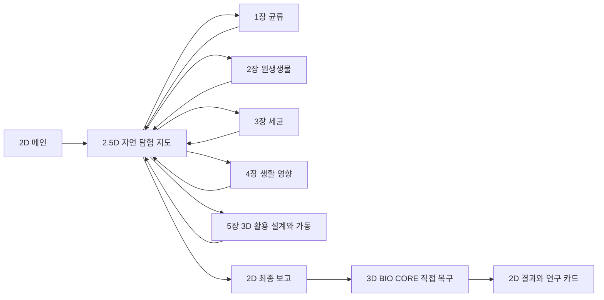

# PRD 생명 코드 연구소

> 2026-10-18 변경: 현재 구현 기준은 [가로 태블릿 탐험 v1.2](TABLET_EXPLORATION.md)다. 2D Phaser 탐험·작업대·코어와 단계별 도구 UI가 이전 3D/2.5D 지정을 대체한다. 아래 v1.1 내용은 당시 설계 기록이며, 학습 완료 조건은 유지한다.

- 버전: 1.1 · 작성일: 2026-10-15 · 수정일: 2026-10-16
- 상태: MVP 설계 기준안. 구현과 사용자 검증은 아직 수행하지 않았다.
- 대상: 초등학교 4학년, 태블릿 가로형 웹. 전체 플레이 목표 35~45분.
- 연결 문서: [태블릿 탐구 경험 설계](INTERACTION_DESIGN.md), [기술 설계](TRD.md), [에셋 계획](ASSET_PLAN.md), [구현 순서와 검증](IMPLEMENTATION_PLAN.md), [화면과 미션 계약](mvp-spec.json).

## 1 목표와 확정 범위

학생이 관찰·비교·자료 분석·생활 영향 조사·활용 설계를 수행하고, 자신의 연구 기록 5종으로 BIO CORE를 복구한다. 화면의 조작 결과가 관찰 자료와 장치 상태에 반영되어야 한다.

2026-10-16 태블릿 학습의 필요성을 강화하는 설계를 반영했다. 각 장은 **조작 → 변화 발견 → 근거 기록 → 설명 확인/수정**을 갖는다. M1은 관찰 조건과 전후 사진, M2는 움직임 재생과 두 시점, M3는 근거에 반응하는 주장 검토, M4는 시간 탐색과 맥락 비교, M5는 예상·가동·결과 대조를 중심으로 한다. 동작 횟수·강제 실패·손의 민첩성을 성취 기준으로 삼지 않는다. 구체적인 상태·피드백·화면 배치는 탐구 경험 설계가 기준이다.

2026-10-15 사용자 선택을 반영한다.

- 메인 다음 **자연 속 스테이지 선택 지도만 사선 시점의 2.5D 픽셀아트 RPG**다. 캐릭터로 길을 따라 움직여 장소에 입장한다.
- 메인, 1~4장, 최종 보고와 결과는 첨부 시안 계열의 **2D 일러스트 화면**이다.
- **5장 조립·가동과 최종 BIO CORE 복구는 실제 3D 물체 + DOM UI**로 만든다. 3D 관찰 사진이나 3D 생물 캐릭터로 과학 자료를 대체하지 않는다.
- 모든 화면 좌측 위에 홈·이전, 우측 위에 소리·설정 아이콘을 둔다.
- 설정의 **관리자 전체 해금** 스위치 하나로 모든 화면을 연다. 섹션별 선택이나 개별 해금 목록은 없다.

학습 흐름은 기존 심화설계 v2의 5장 × 활동 2개를 따른다. 메인과 엔딩까지 포함해 10화면으로 셌던 과거 PRD/TRD의 번호는 적용하지 않는다.

## 2 MVP 구성과 제외 범위

**포함:** 독립 실행 웹앱, 15개 화면, 미션 5개, 관찰 기록 가방, 지도 이동과 시설 복구, 모아 연구원, 저장·이어하기, 전체 해금 미리보기, 3D/2D 대체 조작, 연구 카드 PNG, 인증서 브라우저 인쇄, 소리·큰 글씨·동작 줄이기 설정.

**후속:** 보너스 퀘스트, 복수 활용 사례, 아바타 선택·꾸미기, 캐릭터 추가, 자동 탐구 스타일 분류, 음성 녹음·내레이션, 멀티플레이, 교사 대시보드, 클라우드 저장, 외부 Science World 연동, 설치형 PWA와 완전 오프라인 배포.

MVP는 일반 웹 배포를 기준으로 한다. 다운로드한 에셋의 세션 내 재사용과 브라우저 로컬 저장을 지원한다. 첫 접속부터 오프라인 완주나 서버·서비스 연동을 요구하지 않는다.

## 3 세계관과 전체 흐름

연구소의 BIO CORE에서 데이터 연결 오류가 발생했다. 표본과 발견 장소가 분리되고, 자료와 추측이 섞이고, 생활 영향 안내가 잘못 연결되었다. 모아 연구원이 학생에게 실제 근거를 찾아 연구 기록을 복구해 달라고 부탁한다.

새 게임은 메인에서 시작해 지도에 진입한다. 첫 방문 때 지도 위에서 모아의 짧은 사건 의뢰를 받는다. 기본 경로는 M1부터 순차 해금이다. 각 장 완료 후 지도에 복귀하고 해당 시설이 바뀐다. 중앙 코어는 최종 행동을 마친 뒤에만 복구 완료로 표시한다.

| 미션 | 활동 목표 시간 | 결과물 | 지도와 시설의 변화 |
|---|---|---|---|
| M1 균류의 흔적을 복원하라 | 6분 | E1 균류 관찰 패킷 | 균류 표본실 조명과 관찰 안내 복구 |
| M2 한 방울 속 생물을 찾아라 | 6분 | E2 원생생물 비교 기록 | 수중 관찰 시설 순환 장치 복구 |
| M3 진짜 근거를 찾아라 | 5분 | E3 세균 증거 프로필 | 자료실 정보판 재정렬 |
| M4 생활 속 사건을 해결하라 | 8분 | E4 생활 영향 사건 보고서 | 생활마을 안내와 영향 분석 오류 수정 |
| M5 생명과학으로 해결하라 | 6분 | E5 BIO 솔루션 설계도 | 작업실 가동 및 코어 입력 5개 준비 |

장별 활동 약 31분, 도입·지도 이동·최종 보고·복구·결과 약 8분을 기준으로 잡는다. 시간 제한과 속도에 따른 감점은 없다.

## 4 자연 탐험 지도

중앙 온실 연구소와 버섯숲 표본실, 연못 관찰소, 자료실, 생활마을, BIO 작업실을 하나의 지도에 배치한다. 이는 현재 MVP의 배치 기준이며 개별 건물 위치는 지도 시안에서 조정할 수 있다.

- 플레이어는 기존 노란 조끼 탐험가를 바탕으로 한 캐릭터 1명이다. 모아는 퀘스트·기록 검토·최종 보고 역할을 맡는다.
- 기본 조작은 **목적지 탭 → 길을 따라 이동 → 입구에서 입장 버튼**이다. 키보드는 방향키/WASD와 Enter를 지원한다.
- 지형과 건물에 충돌 처리가 있고, 나무·건물 뒤를 지날 때 가림 순서가 자연스러워야 한다.
- 잠긴 입구에는 다음에 필요한 연구 기록을 알려준다. 길찾기 불가 위치를 탭하면 도달 가능한 가까운 길을 안내한다.
- 가까운 장소로 가는 이동은 목표 5~10초다. 가장자리 탈출이나 오랜 왕복으로 학습 시간을 소모하지 않는다.
- 장소에 재입장하면 미완료 작업 상태를 복원한다. 완료한 장소의 재탐색도 허용한다.
- 완료 변화는 시설의 불·정보판·물 순환 장치에 표현한다. 코어 데이터 오류 때문에 자연 생태계 전체가 죽었다 살아나는 서사는 넣지 않는다.

## 5 장별 시나리오와 완료 조건

### M1 균류의 흔적을 복원하라

**표본실:** 밀폐된 곰팡이 표본과 버섯 표본을 선택한다. BIO 렌즈로 발견 환경을 살피고 시간 기록을 비교해 서로 다른 종류의 환경 단서 2개 이상을 저장한다. 하나의 표본 조건을 모든 균류에 일반화하지 않는다.

**현미경 분석실:** 표본 선택 → 낮은 배율 확인 → 밝기·초점·시야 조절 → 촬영 → 보이는 특징에 표시 → 근거 문장 구성. 조절에 따라 실제 표시 영상의 흐림, 노출, 확대 범위가 변한다.

촬영본을 기준 사진으로 고정하여 현재 시야와 비교한다. 확대 시 같은 표본 위치를 중심으로 시야가 좁아지는 차이를 보여준다. 관찰/표시 모드를 나누고 손가락 옆 확대창과 위치 미세 조절을 제공한다. 일부러 흐린 사진을 만들거나 비교 도구를 일정 횟수 사용하도록 강제하지 않는다.

**완료:** 버섯과 곰팡이 각각 유효 사진 1장, 두 사진에서 유효 특징 표시 총 2곳 이상, 관찰·환경 자료에 연결한 설명 1개. 촬영 여부만으로 완료하지 않는다. 흐린 사진도 보관할 수 있지만 유효 근거로는 인정하지 않고 다시 조절하도록 안내한다.

**학습 결과:** 균류의 특징과 발견 환경을 학생 기록으로 설명한다. 실제 관찰 자료의 종류·장비에 맞게 배율 표기를 사용한다.

### M2 한 방울 속 생물을 찾아라

**채집실:** 연못의 채집 지점 선택 → 스포이드 누르기 → 물속에서 놓기 → 받침 유리로 옮기기 → 표본 상태 확인. 양이 맞지 않으면 같은 화면에서 수정한다. 실제 생물의 수나 분포를 무작위 확률처럼 평가하지 않는다.

**추적실:** 해캄의 형태를 관찰·촬영하고 짚신벌레를 시야 안에서 따라가 촬영한다. 두 기록을 나란히 놓고 생김새·움직임·채집 환경의 3개 항목을 비교한다.

추적 또는 보조 관찰 후 재생 막대·장면 이동으로 같은 대상의 서로 다른 두 시점을 A/B로 고정한다. 고정 좌표계의 경로를 겹쳐 보고 움직임 설명의 근거로 연결한다. 카메라 이동을 생물 이동으로 표시하지 않는다. 교육용 경로에는 모형 표시를 유지한다.

**완료:** 관찰 가능한 표본, 두 생물의 유효 기록 각 1개, 근거가 연결된 비교 3항목. 움직임 설명은 같은 대상의 유효한 두 시점에 연결한다. 추적은 기본 2초 유지로 시작하고 동작 줄이기·보조 조작에서는 정지 장면 탐색으로 동일한 근거를 만든다. 추적 속도는 학습 성취 점수로 쓰지 않는다.

### M3 진짜 근거를 찾아라

**자료 탐색실:** 사진, 발견 장소 기록, 확인된 관찰 메모와 추측·무관 자료를 함께 제시한다. MVP는 6개 자료 후보로 시작한다. 확대·원본 확인 후 근거 후보를 고르고 필요하면 교체한다.

**프로필 분석실:** 특징 설명과 사는 곳 설명에 선택한 근거를 연결한다. 문장 구성은 짧은 문장 조각과 근거 연결로 수행하고 자유 입력은 선택이다.

주장 하나와 선택한 원문 구간을 나란히 놓고, 근거 추가·해제·교체에 따라 ‘근거 부족/확인 가능/이 자료와 맞지 않음’을 즉시 갱신한다. 자료 유형만으로 정답을 결정하지 않고 검수된 원문 구간과 주장 관계로 판정한다. 잘못 연결하거나 수정을 한 번 거쳐야 하는 조건은 없다.

**완료:** 사진·장소·관찰 메모 3종을 포함한 관련 근거 3개 이상, 원문 구간에 연결한 특징 설명 1개, 사는 곳 설명 1개. 카드 개수만 채우거나 근거 없는 문장만 완성해서 통과할 수 없다.

### M4 생활 속 사건을 해결하라

**사건실:** 다음 4개 사건 중 빵 곰팡이를 시간 탐색의 대표 활동으로 제공하고 나머지는 짧은 자료 조사로 구성한다. 약 3분은 대표 탐구, 3분은 나머지 사건, 2분은 분석실 비교에 배분한다.

| 사건 | 관련 생물군 | 판단의 초점 |
|---|---|---|
| 요구르트 발효 | 세균 | 특정 세균의 작용을 음식 만들기에 이용 |
| 빵의 곰팡이 | 균류 | 이 상황에서 식품 이용에 문제가 생김 |
| 낙엽 분해 | 균류·세균 | 죽은 생물의 물질이 분해되는 역할 |
| 물속 먹이 관계 | 원생생물 사례 | 다른 생물의 먹이 관계와 사람 생활의 연결 |

마지막 사건의 구체적인 원생생물·그림·설명은 교과 검수에서 확정한다. 식물성 플랑크톤 전체를 원생생물로 분류하거나 해캄·짚신벌레에 모든 역할을 부여하지 않는다.

빵의 같은 표본을 관찰한 최소 4시점 기록에서 시간 막대를 앞뒤로 움직이고 전후 A/B를 고정한다. 나란히 보기·경계 밀기 비교에서 변화 영역을 표시해 근거로 남긴다. 기록이 없는 중간 상태를 합성하지 않는다. 시간이 불명확하면 ‘관찰 순서’로 표시한다. 변화 시점 쌍은 하나의 근거이며 관련 생물/작용 자료를 별도 근거로 요구한다. 옛 시안의 꿀벌·녹조·대나무 표는 현재 사례로 교체한다.

**분석실:** 사건 → 관련 생물/작용 → 이 상황의 영향 → 근거 순으로 연결한다. 자료가 모순되면 사건 원본을 바로 다시 열 수 있다.

중앙에는 학생이 만든 빵 이용·낙엽 분해 기록을 나란히 놓는다. 완성 표와 보고서는 시작 화면에 정답으로 제시하지 않고 학생의 연결 결과로 구성한다.

**완료:** 4개 사건별 독립적인 관련 근거 2개 이상과 설명, 빵의 유효 시점 쌍·변화 표시, 곰팡이 변질 사례와 분해 사례를 비교한 맥락 설명 1개. 유효한 전후 조합은 여러 개를 허용한다. 도움/문제 버튼만 누르는 활동으로 끝나지 않는다. 생물군 자체에 선악 속성을 붙이지 않는다.

### M5 생명과학으로 해결하라

생활마을의 요청은 **생물의 작용을 활용해 요구르트를 만드는 방법을 소개하자**다. MVP 활용 사례는 1종으로 제한한다. 사례 자료를 읽고 4장에서 조사한 발효 기록을 다시 사용한다.

**3D 조립실:** 입력·생물 작용·결과 모듈을 공통 작업대의 빈 자리 3개에 배치하고 흐름을 연결한다. 모듈의 외형이나 빈 자리 모양만으로 정답이 드러나지 않게 한다. 학생은 재료와 생물/작용 자료를 연결해야 한다.

**3D 가동실:** 결과 예상·이유 기록 → RUN 레버 조작 → 흐름과 결과 관찰 → 예상/관찰 대조 → 필요한 관계 수정 → 재실행. 이전 실행이 있으면 변경한 설계와 결과를 나란히 비교한다. 투명창·흐름선은 해당 설계의 입력·작용·결과를 표시한다. 연결 누락, 사례와 작용 불일치, 결과 선택 불일치를 구분하여 근거를 다시 살필 수 있게 하며 정답 위치를 자동 공개하지 않는다.

**완료:** 사례 근거 확인, 입력·작용·결과의 유효 연결, 사례와 맞는 생물의 작용, 현재 설계 버전의 성공 RUN 1회, 해당 RUN 전 예상과 예상/결과 대조, 근거를 연결한 활용 설명. 예상의 오답은 감점하지 않는다. 처음 성공한 학생에게 불필요한 실패·재시도를 강제하지 않는다. 성공 후 설계를 바꾸면 현재 초안은 다시 가동하여 확인한다.

장치는 교육용 관계 모델이다. 실제 제조 온도·시간·수율과 미생물 배양 절차를 학습 목표나 정량 시뮬레이션으로 넣지 않는다.

## 6 최종 보고와 직접 복구

1. 지도 중앙 연구소에서 모아에게 연구 기록 5종을 전달한다. 학생이 만든 사진·비교·선별 자료·보고서·설계 결과가 보인다.
2. 최종 보고는 새 시험이 아니다. 전달할 기록을 열어 보고 확인할 수 있다.
3. 3D 코어의 관찰·비교·자료·영향·활용 포트에 연구 기록을 연결한다. 이동 조작과 함께 기록 선택 → 포트 선택 방식도 제공한다.
   카트리지에는 학생의 실제 사진·주석·두 시점·근거 연결·실행 결과를 표시한다. 연결할 때 자신의 기록이 확대되어 발견을 되짚고 접힌다. 회고는 건너뛰기와 정지 카드 대체를 제공하며 추가 시험·중복 확인 조건을 만들지 않는다.
4. 5개 기록의 연결을 확인한 뒤 레버를 아래로 당기거나 동등한 가동 버튼을 누른다.
5. 코어 복구 후 짧은 8~12초 인앱 연출을 보여준다. 건너뛰기·동작 줄이기를 제공하고 별도 생성 영상은 요구하지 않는다.
6. 결과에서 대표 사진, 활용 사례, 관련 생물/작용, 근거가 들어간 연구 카드를 편집·PNG 저장한다. 인증서는 같은 결과 데이터로 A4 인쇄한다.

전체 해금 미리보기에서는 예시 기록으로 모든 후속 화면을 볼 수 있다. 일반 학습 완료는 학생의 실제 기록과 최종 행동으로만 판정한다.

## 7 재미와 학습의 연결

| 장치 | 플레이어가 느끼는 변화 | 학습과의 관계 |
|---|---|---|
| 지도 시설 복구 | 돌아올 때 전과 다른 공간 | 자신이 완료한 탐구의 결과 확인 |
| 연구 기록 가방 | 실제 사진과 자료가 누적 | 앞선 기록을 다음 미션에서 재사용 |
| 초점·추적·가동 반응 | 손 조작에 따른 현상 변화 | 관찰 조건과 작용 관계를 이해 |
| 상태를 유지하는 재시도 | 한 단계만 수정해 재실행 | 오류 원인을 보고 조정 |
| 모아의 상황별 한두 문장 | 다음 장소에 갈 이유 제시 | 지금 필요한 근거를 인식 |

별·코인·랭킹·로그인 보상은 MVP에 추가하지 않는다. 완료/추가 기록 표시는 가능하되 힌트 사용을 감점하거나 공개 순위를 만들지 않는다.

## 8 화면과 공통 UI

총 15개 독립 화면이며, 이 중 핵심 학습 화면은 10개다. 화면 ID가 문서·라우트·저장·에셋 연결의 기준이다.

| 화면 ID | 표시 이름 | 주 렌더 | 기본 이전 화면 |
|---|---|---|---|
| `main` | 생명 코드 연구소 | dom-2d | 비활성 |
| `nature-map` | 자연 탐험 지도 | phaser-pixel | `main` |
| `fungi-field` | 균류 표본실 | phaser-2d | `nature-map` |
| `fungi-microscope` | 현미경 분석실 | canvas-2d | `fungi-field` |
| `water-sampling` | 한 방울 채집실 | phaser-2d | `nature-map` |
| `protist-observation` | 원생생물 추적실 | canvas-2d | `water-sampling` |
| `bacteria-sources` | 세균 자료 탐색실 | dom-2d | `nature-map` |
| `bacteria-profile` | 세균 프로필 분석실 | dom-2d | `bacteria-sources` |
| `impact-investigation` | 생활 사건실 | phaser-2d | `nature-map` |
| `impact-analysis` | 영향 분석실 | dom-2d | `impact-investigation` |
| `solution-assembly` | BIO 솔루션 연구소 | three-3d | `nature-map` |
| `solution-run` | BIO 솔루션 가동실 | three-3d | `solution-assembly` |
| `final-report` | 최종 연구 보고 | dom-2d | `nature-map` |
| `core-restoration` | BIO CORE 복구 | three-3d | `final-report` |
| `results` | 연구소 복구 완료 | dom-2d | `core-restoration` |

- **홈:** 저장 후 메인으로 간다. 시작 화면에서는 현재 위치를 표시하며 비활성 상태다.
- **이전:** 열린 모달·기록 뷰어를 먼저 닫는다. 그렇지 않으면 위 표의 이전 화면으로 간다. 근거 원본으로 잠시 이동한 경우에는 원래 작업 화면으로 돌아간다.
- **소리:** 전체 음소거 상태를 즉시 바꾸고 저장한다. 설정에서 BGM·효과음 음량을 개별 조절한다.
- **설정:** 음량, 큰 글씨, 동작 줄이기, 관리자 전체 해금 스위치를 같은 패널에 둔다.
- **관리자 전체 해금:** 한 번 켜면 15개 화면에 모두 접근한다. 뒤 단계에서 필요한 선행 자료가 없으면 표시된 예시 자료를 사용한다. 미리보기 기록·완료·보상은 일반 학습 저장과 분리한다. 끄면 일반 진도에 맞는 지도 상태로 돌아간다.
- 메인에도 홈·이전 아이콘이 보이며 이전은 비활성이다. 모달에서 코너 제어는 보이고 홈/이전 입력은 현재 조작을 안전하게 종료한 뒤 수행한다.
- 연구 기록 가방은 하단 보조 버튼으로 연다. 기본 화면의 주 행동 버튼은 하나만 강조한다.
- 관찰 중에는 중앙 약 70%에 현상과 조작 대상을 배치하고, 오른쪽은 접을 수 있는 근거/도구 패널로 쓴다. 좁은 화면은 보조 패널을 접고 실제 터치 크기를 유지한다. 하단에는 현재 활동의 도구만 둔다. 정리 화면은 학생 기록 중심으로 전환한다.
- 캐릭터·긴 설명·완성 보고서는 탐구 중 접고 요청 시 연다. 전체 화면을 정답 표와 장식으로 채우지 않는다. 구체 배치와 15화면 우선 표시는 탐구 경험 설계를 따른다.

## 9 화면 크기와 접근성

1280×800과 1024×768, 16:9의 1280×720에서 확인한다. 지도 픽셀아트와 다른 화면의 고해상도 UI를 분리한다.

- 모든 아이콘 터치 영역은 실제 CSS 기준 48×48px 이상, 주요 가동·제출 버튼 높이는 56px 이상이다.
- 본문 18~22px, 핵심 안내 22~28px를 기준으로 하고 큰 글씨에서 줄바꿈·영역 높이를 함께 바꾼다. 제목은 28~40px를 사용한다.
- 전자칠판에서는 큰 글씨 모드를 사용한다. 뒷자리 가독성은 실제 기기 확인 전까지 검증 완료로 표시하지 않는다.
- 일반 텍스트 대비 4.5:1, 큰 텍스트 3:1을 목표로 측정한다. 읽는 본문은 불투명 패널에 올린다.
- 한글 줄바꿈은 어절 기준이다. 이미지 안의 한글 UI를 그대로 사용하지 않는다.
- 터치·마우스·키보드로 핵심 행동을 수행할 수 있다. 드래그, 긴 누르기, 빠른 추적만을 유일한 완료 수단으로 두지 않는다.
- 설정·기록 패널을 열면 뒤쪽의 추적·가동·이동이 멈춘다. 색과 소리 외에 글자·형태로 상태를 알린다.
- 세로 화면은 회전 안내와 재배치된 최소 제어를 제공한다. 기록 저장·홈·설정 접근을 막지 않는다.

## 10 저장과 이어하기

자동 저장 대상은 현재 화면과 미션 초안, 관찰 사진·표시, 선별 자료, 사건 보고서, 설계도·RUN 기록, 완료 연구 기록, 지도 위치, 최종 보고·복구 상태와 설정이다.

촬영과 결과물 확정은 저장 성공 후 표시한다. 화면 이동 때 초안을 저장한다. 저장 실패 시 현재 작업을 유지하고 저장되지 않았음을 알린다. 가득 찬 저장소 때문에 이전 기록을 자동 삭제하지 않는다.

메인에서 계속하기를 제공한다. 새 연구 시작은 기존 기록 처리 방식을 보여주고 확인받은 뒤 수행한다. 학생 이름은 인증서 출력 시 선택 입력하며 서버로 보내지 않는다.

## 11 콘텐츠와 에셋 검수

기존 PNG는 시안·배경·캐릭터 설정화로 활용한다. 현재 과학 관찰 자료의 독립 파일, 픽셀 지도·걷기 애니메이션, 3D 모델·오디오는 준비되지 않았다.

콘텐츠는 문장·자료 출처·사용 권한·관찰 대상·검수 상태를 기록한다. AI 생성 그림은 설명용 도식으로 표시하고 실제 관찰 사진으로 소개하지 않는다. 실제 학생 대상 공개에는 검수된 관찰 이미지와 사례 데이터가 필요하다.

교육과정 연결은 기존 자료의 [4과12-01] 관찰·특징·사는 곳, [4과12-02] 생활 영향 조사·설명, [4과12-03] 활용 소개 자료 제작을 설계 기준으로 삼는다. 학교에서 사용할 교육과정 판본과 세부 표현은 콘텐츠 검수 때 확인한다.

## 12 MVP 수용 기준

| ID | 수용 기준 |
|---|---|
| AC-01 | 15개 화면 이동, 모든 화면의 코너 제어, 이전/홈 복귀가 동작한다. |
| AC-02 | 지도 탭 이동·충돌·가림·입장·순차 해금·시설 변화와 위치 복원이 동작한다. |
| AC-03 | M1 두 표본 촬영·실제 화면 변화·특징 표시·근거 설명을 만족해야 E1이 생성된다. |
| AC-04 | M2 표본 준비·두 생물 기록·3항목 비교를 만족해야 E2가 생성된다. |
| AC-05 | M3 자료 3종과 특징/장소 근거를 검증하며 추측·무관 자료만으로 완료할 수 없다. |
| AC-06 | M4 네 사건과 근거·상황 비교를 검증하고 단순 도움/문제 선택만으로 완료할 수 없다. |
| AC-07 | M5 3D 배치·연결·RUN·실패 후 수정과 2D 대체 조작이 같은 규칙을 사용한다. |
| AC-08 | 최종 보고에서 실제 기록을 재사용하고 코어 직접 가동 후에만 일반 연구 완료를 확정한다. |
| AC-09 | 전체 해금 한 번으로 모든 화면을 미리 보고 일반 학습 진도와 기록이 변하지 않는다. |
| AC-10 | 새로고침·화면 왕복 후 초안/사진/설정이 복원되고 연구 카드 PNG와 인증서 인쇄가 동작한다. |
| AC-11 | 세 목표 화면 크기에서 주요 제어가 잘리지 않고 보조 조작·음소거·동작 줄이기가 동작한다. |
| AC-12 | 출처·권한·과학 검수를 완료하고 목표 기기에서 성능·저장·3D 대체를 확인한 뒤 학생용 배포한다. |
| AC-13 | M1 조건 변화·촬영·주석 좌표가 일치하며 기준 사진 비교가 원본을 바꾸지 않는다. |
| AC-14 | M2 같은 대상의 두 시점·경로를 재생/정지로 비교하고 보조 입력도 동일하게 완료한다. |
| AC-15 | M3 근거 연결 변경에 따라 주장 상태와 원문 표시가 갱신되고 근거 없는 설명은 통과하지 않는다. |
| AC-16 | M4 같은 표본의 검수된 시점 쌍·변화 표시·독립 근거와 맥락 비교를 검증한다. |
| AC-17 | M5 설계 버전별 예상·RUN·대조를 저장하고 이전 실행 비교·복원·2D 전환에서 유지한다. |
| AC-18 | 최종 코어에 실제 학생 기록을 표시하고 회고 건너뛰기와 동작 줄이기를 지원한다. |
| AC-19 | 세 목표 크기에서 가림·주요 행동·보조 입력을 검증하고 각 장의 고유 탐구를 수행할 수 있다. |

구현되지 않은 항목은 예정 상태다. 문서 검사, 데스크톱 브라우저 확인, 실제 태블릿·교과 검수를 각각 구분해 기록한다.

